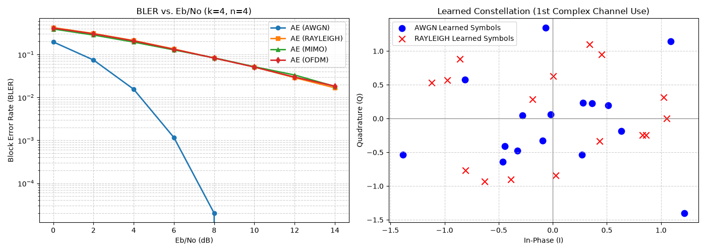

# Deep learning for end-to-end PHY optimization
A full investigation, proposals, optimization, pros n cons, benefits and scalability with DL for Physical Layer

# Thoughts
Can we do AE (autoencoder) implementation with lower training and processing complexity? which means a novel low complexity 
AE architecture to implement E2E learning of coded systems in which we can have shown better __BER performance__ than the
baseline model of a conventional communications system implementation. 

What is deployment challenges? - Comutational complexity, latency due to strict timing budgets for UL/Dl PHY processing, what 3GPP standardization says for OTA training protocols and feedback loops?  

Specific architectures e.g., Turbo Autoencoders, OFDM-AE, MIMO beamforming, or semantic PHY?

what OTA training techniques needed for real HW? 

# Pseducode with TensorFlow
Here is a complete, runnable TensorFlow 2.x implementation featuring a modular channel layer supporting AWGN, 
Rayleigh Fading, 2x2 MIMO, and OFDM, along with integrated Matplotlib visualization scripts for learned 
constellations and BLER performance curves of an end-to-end **communication autoencoder**.

```python

import tensorflow as tf
import numpy as np
import matplotlib.pyplot as plt

# 1. System Parameters
k = 4                   # Information bits per message (M = 16 messages)
M = 2**k                # Alphabet size
n_complex = 4           # Number of complex channel uses (or subcarriers for OFDM)
R = k / n_complex       # Code rate (bits per complex symbol)
eb_no_db_train = 10.0   # Training SINR (Eb/No in dB)

# 2. Custom Differentiable Channel Layer (AWGN, Rayleigh, MIMO, OFDM)
class WirelessChannelLayer(tf.keras.layers.Layer):
    def __init__(self, channel_type='awgn', **kwargs):
        super().__init__(**kwargs)
        self.channel_type = channel_type.lower()

    def call(self, inputs, eb_no_db):
        # inputs shape: (batch_size, n_complex, 2) -> [Real, Imaginary]
        x_real, x_imag = inputs[..., 0], inputs[..., 1]
        x_complex = tf.complex(x_real, x_imag)
        batch_size = tf.shape(x_complex)[0]

        # Calculate complex noise standard deviation
        eb_no = tf.pow(10.0, eb_no_db / 10.0)
        noise_std = tf.sqrt(1.0 / (2.0 * R * eb_no))
        noise = tf.complex(
            tf.random.normal(tf.shape(x_complex), stddev=noise_std),
            tf.random.normal(tf.shape(x_complex), stddev=noise_std)
        )
        # For each channel type ...
        if self.channel_type == 'awgn':
            y_complex = x_complex + noise

        elif self.channel_type == 'rayleigh':
            # Flat Rayleigh fading: h ~ CN(0, 1)
            h = tf.complex(
                tf.random.normal(tf.shape(x_complex), stddev=np.sqrt(0.5)),
                tf.random.normal(tf.shape(x_complex), stddev=np.sqrt(0.5))
            )
            y_complex = h * x_complex + noise
            # Assume perfect Channel State Information (CSI) equalization at receiver
            y_complex = y_complex / (h + 1e-8)

        elif self.channel_type == 'mimo':
            # 2x2 Spatial Multiplexing MIMO (requires n_complex to be even)
            assert n_complex % 2 == 0, "n_complex must be even for 2x2 MIMO"
            x_mimo = tf.reshape(x_complex, (batch_size, n_complex // 2, 2, 1))
            H = tf.complex(
                tf.random.normal((batch_size, n_complex // 2, 2, 2), stddev=np.sqrt(0.5)),
                tf.random.normal((batch_size, n_complex // 2, 2, 2), stddev=np.sqrt(0.5))
            )
            n_mimo = tf.reshape(noise, (batch_size, n_complex // 2, 2, 1))
            y_mimo = tf.matmul(H, x_mimo) + n_mimo
            # Zero-Forcing (ZF) Equalization: H^+ * y
            # H_pinv = tf.linalg.pinv(H)
            # Add tiny diagonal regularization (1e-6) to prevent singular matrix errors
            eps = tf.cast(1e-6, H.dtype) * tf.eye(tf.shape(H)[-1], dtype=H.dtype)
            H_pinv = tf.linalg.inv(H + eps)
            # Formula: (H^H * H + eps*I)^(-1) * H^H
            # H_H = tf.linalg.adjoint(H)
            # gram = tf.matmul(H_H, H)
            # eps = tf.cast(1e-6, H.dtype) * tf.eye(tf.shape(gram)[-1], dtype=H.dtype)
            # H_pinv = tf.matmul(tf.linalg.inv(gram + eps), H_H)
            y_eq = tf.matmul(H_pinv, y_mimo)
            y_complex = tf.reshape(y_eq, (batch_size, n_complex))

        elif self.channel_type == 'ofdm':
            # Frequency-selective Rayleigh multipath channel (2 taps) + FFT/IFFT
            time_signal = tf.signal.ifft(x_complex)
            # 2-tap impulse response padded to n_complex
            taps = tf.complex(
                tf.random.normal((batch_size, 2), stddev=np.sqrt(0.25)),
                tf.random.normal((batch_size, 2), stddev=np.sqrt(0.25))
            )
            h_padded = tf.pad(taps, [[0, 0], [0, n_complex - 2]])
            H_freq = tf.signal.fft(h_padded)
            
            # Circular convolution in frequency domain + AWGN
            rx_freq = H_freq * tf.signal.fft(time_signal) + noise
            # Single-tap Frequency Domain Equalization (FDE)
            y_complex = rx_freq / (H_freq + 1e-8)

        else:
            raise ValueError("Unsupported channel type. Choose 'awgn', 'rayleigh', 'mimo', or 'ofdm'.")

        # Stack Real and Imaginary back to float tensor: (batch_size, n_complex, 2)
        return tf.stack([tf.math.real(y_complex), tf.math.imag(y_complex)], axis=-1)

# 3. End-to-End Autoencoder Model
class TFCommunicationAutoencoder(tf.keras.Model):
    def __init__(self, M, n_complex, channel_type='awgn'):
        super().__init__()
        self.M = M
        self.n_complex = n_complex
        
        # Encoder
        self.enc_dense1 = tf.keras.layers.Dense(M, activation='elu')
        self.enc_dense2 = tf.keras.layers.Dense(2 * n_complex, activation='linear')
        
        # Channel
        self.channel = WirelessChannelLayer(channel_type=channel_type)
        
        # Decoder
        self.dec_flatten = tf.keras.layers.Flatten()
        self.dec_dense1 = tf.keras.layers.Dense(M * 2, activation='elu')
        self.dec_dense2 = tf.keras.layers.Dense(M, activation='linear')

    def encode(self, one_hot_x):
        x = self.enc_dense1(one_hot_x)
        x = self.enc_dense2(x)
        x = tf.reshape(x, (-1, self.n_complex, 2))
        # Power normalization: Average complex symbol power E[|x|^2] = 1
        power = tf.reduce_mean(tf.reduce_sum(tf.square(x), axis=-1))
        return x / tf.sqrt(power + 1e-8)

    def decode(self, y):
        y = self.dec_flatten(y)
        y = self.dec_dense1(y)
        return self.dec_dense2(y)

    def call(self, one_hot_x, eb_no_db=10.0):
        tx = self.encode(one_hot_x)
        rx = self.channel(tx, eb_no_db=eb_no_db)
        return self.decode(rx)

# 4. Training Function
def train_autoencoder(channel_type, epochs=1500, batch_size=512):
    model = TFCommunicationAutoencoder(M, n_complex, channel_type=channel_type)
    optimizer = tf.keras.optimizers.Adam(learning_rate=0.005)
    loss_fn = tf.keras.losses.SparseCategoricalCrossentropy(from_logits=True)

    @tf.function
    def train_step(labels, one_hot_x):
        with tf.GradientTape() as tape:
            logits = model(one_hot_x, eb_no_db=eb_no_db_train)
            loss = loss_fn(labels, logits)
        grads = tape.gradient(loss, model.trainable_variables)
        optimizer.apply_gradients(zip(grads, model.trainable_variables))
        return loss

    print(f"Training on [{channel_type.upper()}] channel...")
    for epoch in range(epochs):
        labels = tf.random.uniform((batch_size,), minval=0, maxval=M, dtype=tf.int32)
        one_hot_x = tf.one_hot(labels, depth=M)
        loss = train_step(labels, one_hot_x)
        if (epoch + 1) % 500 == 0:
            print(f"  Epoch {epoch+1}/{epochs} - Loss: {loss.numpy():.4f}")
    return model

# 5. Evaluation & Visualization Suite
channels_to_test = ['awgn', 'rayleigh', 'mimo', 'ofdm']
trained_models = {}
eb_no_range = np.arange(0, 15, 2)
bler_results = {ch: [] for ch in channels_to_test}

# Train all models
for ch in channels_to_test:
    trained_models[ch] = train_autoencoder(ch, epochs=1500)

# Evaluate BLER across SNR range
test_samples = 50000
test_labels = tf.random.uniform((test_samples,), minval=0, maxval=M, dtype=tf.int32)
test_one_hot = tf.one_hot(test_labels, depth=M)

for ch in channels_to_test:
    model = trained_models[ch]
    for snr in eb_no_range:
        logits = model(test_one_hot, eb_no_db=float(snr))
        preds = tf.argmax(logits, axis=-1, output_type=tf.int32)
        bler = tf.reduce_mean(tf.cast(preds != test_labels, tf.float32)).numpy()
        bler_results[ch].append(bler)

# --- PLOT 1: BLER vs. Eb/No Curves ---
plt.figure(figsize=(14, 5))

plt.subplot(1, 2, 1)
markers = ['o', 's', '^', 'd']
for idx, ch in enumerate(channels_to_test):
    plt.semilogy(eb_no_range, bler_results[ch], marker=markers[idx], linewidth=2, label=f'AE ({ch.upper()})')

plt.title(f'BLER vs. Eb/No (k={k}, n={n_complex})')
plt.xlabel('Eb/No (dB)')
plt.ylabel('Block Error Rate (BLER)')
plt.grid(True, which='both', linestyle='--', alpha=0.6)
plt.legend()

# --- PLOT 2: Learned Constellation Diagram (Subcarrier/Symbol 1) ---
plt.subplot(1, 2, 2)
all_messages = tf.one_hot(tf.range(M), depth=M)

# Plot learned constellations for AWGN vs Rayleigh on the 1st complex channel use
for ch, color, marker in [('awgn', 'blue', 'o'), ('rayleigh', 'red', 'x')]:
    constellation = trained_models[ch].encode(all_messages).numpy()
    I = constellation[:, 0, 0] # In-phase (Real) of 1st complex symbol
    Q = constellation[:, 0, 1] # Quadrature (Imag) of 1st complex symbol
    plt.scatter(I, Q, c=color, marker=marker, s=80, label=f'{ch.upper()} Learned Symbols')

plt.axhline(0, color='gray', linewidth=0.8)
plt.axvline(0, color='gray', linewidth=0.8)
plt.title('Learned Constellation (1st Complex Channel Use)')
plt.xlabel('In-Phase (I)')
plt.ylabel('Quadrature (Q)')
plt.grid(True, linestyle='--', alpha=0.6)
plt.legend()

plt.tight_layout()
plt.show()

```

## Output of the TensorFlow Script

Example output of the script above: BLER vs. Eb/No curves for the four channel models (left) and the learned
constellations of the AWGN and Rayleigh autoencoders on the first complex channel use (right).



## Key Additions in this TensorFlow Script

* Complex-Valued Signal Flow (tf.complex): Real and imaginary neural network outputs are converted into true complex tensors (I + jQ).
  This enables native frequency-domain transforms (tf.signal.fft/ifft) and matrix algebra (tf.linalg.pinv) inside the backpropagation graph.

* Channel Equalization: For Rayleigh, 2x2 MIMO, and OFDM, the channel layer includes Zero-Forcing / single-tap frequency domain equalization
  assuming known Channel State Information (CSI). Without equalization, random phase rotations prevent the receiver from converging.
